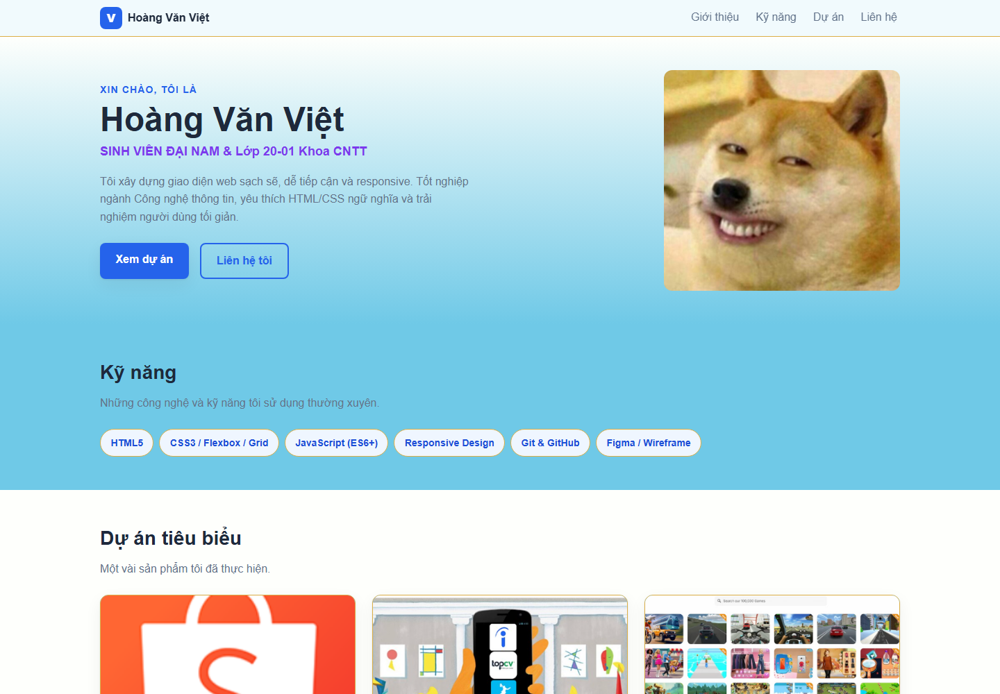
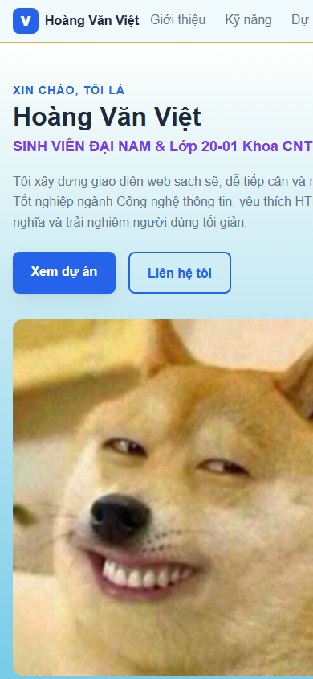

# BÁO CÁO KIỂM THỬ WEBSITE PORTFOLIO/CV

## 1. Thông tin chung

| Hạng mục | Chi tiết |
|---|---|
| Đối tượng kiểm thử | Website portfolio/CV cá nhân |
| Phiên bản | v1.0 |
| Ngày kiểm thử | 27/10/2026 |
| Môi trường | Windows, Google Chrome; mở trực tiếp `index.html` |
| Kích thước màn hình | Máy tính: 1440 × 1000 px; điện thoại: 390 × 844 px |
| Phạm vi | Kiểm tra thủ công giao diện, nội dung, điều hướng, tài nguyên tĩnh và khả năng triển khai ở mức cấu trúc |

Đây là website tĩnh, không có máy chủ ứng dụng, cơ sở dữ liệu hoặc chức năng JavaScript. Vì vậy, báo cáo không xác nhận hoạt động của dịch vụ đăng nhập, API, cơ chế lưu dữ liệu hay triển khai trên môi trường Internet.

## 2. Tổng hợp kết quả

| # | Tiêu chí | Kết quả | Đánh giá |
|---|---|---|---|
| 1 | Tính đúng đắn | Các mục nội dung, ảnh và liên kết điều hướng nội bộ hiển thị; một số liên kết và chức năng đăng nhập chưa hoạt động. | Đạt một phần |
| 2 | Giao diện và trải nghiệm người dùng (UI/UX) | Giao diện máy tính hiển thị; tại chiều rộng 390 px, thanh điều hướng và một số dòng chữ bị cắt theo chiều ngang. | Chưa đạt trên điện thoại |
| 3 | Khả năng vận hành và xử lý lỗi | Có thể mở trang tĩnh; chưa có xử lý trạng thái gửi biểu mẫu hoặc thông báo lỗi. | Đạt một phần |
| 4 | Bảo mật | Chỉ rà soát mã nguồn tĩnh; không kiểm thử xâm nhập, máy chủ hoặc xác thực. | Chưa đủ cơ sở kết luận toàn diện |
| 5 | Chất lượng mã nguồn | HTML/CSS tách tệp và có cấu trúc nội dung; biểu mẫu và một số liên kết còn là bản minh họa. | Đạt một phần |
| 6 | Khả năng triển khai | Có thể phục vụ như website tĩnh, không cần bước build; chưa triển khai lên máy chủ hoặc kiểm tra môi trường production. | Đạt một phần |

## 3. Kết quả theo từng tiêu chí

### 3.1. Tính đúng đắn

**Cách kiểm tra:** Mở trang, quan sát tiêu đề và các mục Giới thiệu, Kỹ năng, Dự án, Liên hệ; kiểm tra liên kết điều hướng nội bộ, ảnh và các thẻ dự án.

**Kết quả:**

- Trang mở được; bốn mục nội dung chính và bốn thẻ dự án được hiển thị.
- Các liên kết điều hướng nội bộ trỏ đến mục tương ứng; cả năm ảnh được tải trong phiên kiểm tra.
- Liên kết GitHub, LinkedIn và “Sign up” đang dùng `href="#"`, không điều hướng đến hồ sơ hoặc chức năng thực tế.
- Biểu mẫu “Sign in” chỉ là giao diện minh họa; chưa có luồng đăng nhập hoặc thông báo kết quả.

**Đánh giá: Đạt một phần.** Nội dung và điều hướng chính có thể sử dụng; các liên kết giữ chỗ và biểu mẫu minh họa cần được hoàn thiện hoặc ghi rõ trạng thái trước khi phát hành.

### 3.2. Giao diện và trải nghiệm người dùng (UI/UX)

**Cách kiểm tra:** Quan sát ảnh chụp trang ở kích thước máy tính 1440 × 1000 px và điện thoại 390 × 844 px.

**Kết quả:**

- Ở kích thước máy tính, phần đầu trang, giới thiệu, kỹ năng và bố cục lưới dự án hiển thị.
- Ở kích thước điện thoại, một số mục điều hướng trên đầu trang và nội dung ở phần giới thiệu tràn khỏi vùng nhìn thấy, bị cắt ngang.
- Hai ô nhập email và mật khẩu chưa có nhãn liên kết với trường nhập; biểu mẫu dùng nội dung tiếng Anh trong trang tiếng Việt.

**Đánh giá: Chưa đạt trên điện thoại.** Cần sửa bố cục để văn bản và điều hướng tự xuống dòng hoặc vừa với màn hình nhỏ, sau đó kiểm tra lại trên nhiều chiều rộng.

### 3.3. Khả năng vận hành và xử lý lỗi

**Cách kiểm tra:** Mở trực tiếp tệp HTML và kiểm tra sự hiện diện của hành động gửi biểu mẫu, trạng thái thành công/thất bại và xử lý lỗi phía ứng dụng.

**Kết quả:**

- Trang tĩnh mở được bằng Chrome khi các tệp giao diện và tài nguyên có sẵn.
- Không có máy chủ ứng dụng hay mã JavaScript phía trang để xử lý xác thực, gửi dữ liệu hoặc hiển thị trạng thái lỗi.
- Chưa có trường hợp xử lý lỗi gửi biểu mẫu để kiểm thử; việc tải thành công cục bộ không xác nhận hoạt động trên máy chủ triển khai.

**Đánh giá: Đạt một phần trong phạm vi trang tĩnh.** Nếu không triển khai đăng nhập, nên bỏ biểu mẫu minh họa hoặc ghi rõ đây không phải chức năng thật. Nếu bổ sung chức năng, cần có trạng thái đang gửi, thành công, thất bại và hướng dẫn khắc phục phù hợp.

### 3.4. Bảo mật

**Cách kiểm tra:** Rà soát tĩnh HTML/CSS và các bề mặt xử lý dữ liệu có trong phạm vi trang; không nhập thông tin đăng nhập thật.

**Kết quả:**

- Phạm vi kiểm thử là website tĩnh; không tìm thấy luồng API, cơ sở dữ liệu hoặc mã JavaScript của ứng dụng trong phạm vi đã kiểm tra.
- Các ô nhập email và mật khẩu thuộc biểu mẫu minh họa; báo cáo không xác nhận có hay không có xử lý xác thực phía máy chủ.
- Chưa thực hiện quét lỗ hổng, kiểm thử xâm nhập, đánh giá máy chủ, cấu hình HTTPS hoặc các tiêu đề bảo mật.

**Đánh giá: Chưa đủ cơ sở kết luận toàn diện.** Không sử dụng biểu mẫu minh họa để nhập mật khẩu thật. Trước khi phát hành, cần xác định rõ có giữ biểu mẫu hay không; nếu triển khai đăng nhập, phải đánh giá riêng luồng xác thực và bảo vệ dữ liệu trên máy chủ.

### 3.5. Chất lượng mã nguồn

**Cách kiểm tra:** Rà soát cấu trúc HTML, stylesheet, nội dung biểu mẫu và liên kết trong mã nguồn.

**Điểm tốt:** Nội dung được tổ chức theo các phần; CSS nằm trong tệp riêng; ảnh có văn bản thay thế; stylesheet có bố cục thích ứng và lưới dự án.

**Điểm cần cải thiện:** Biểu mẫu đăng nhập còn là giao diện mẫu, các trường nhập chưa có nhãn, một số liên kết dùng `#`, và CSS của biểu mẫu được nhúng trực tiếp trong HTML thay vì stylesheet riêng.

**Đánh giá: Đạt một phần.** Nên xử lý các điểm trên và kiểm tra HTML/CSS bằng bộ kiểm tra phù hợp trước khi phát hành. Báo cáo này không xác nhận đã chạy validator hoặc linter.

### 3.6. Khả năng triển khai

**Cách kiểm tra:** Xem xét cấu trúc dự án và mở `index.html` cùng tài nguyên cục bộ trong trình duyệt.

**Kết quả:**

- Trang sử dụng HTML, CSS và hình ảnh tĩnh; không cần bước biên dịch hoặc cài thư viện để xem nội dung.
- Cấu trúc phù hợp để phục vụ bằng máy chủ web tĩnh; có thể mở bằng trình duyệt hoặc dùng máy chủ tĩnh cục bộ theo hướng dẫn trong README.
- Chưa triển khai lên hosting, tên miền hoặc môi trường production; chưa kiểm tra HTTPS, cấu hình máy chủ hay quy trình CI/CD.

**Đánh giá: Đạt một phần.** Có thể triển khai theo mô hình website tĩnh, nhưng cần chạy thử trên môi trường đích và kiểm tra lại liên kết, tài nguyên, HTTPS cùng hiển thị thực tế trước khi công bố.

## 4. Ảnh chụp minh chứng

Ảnh được chụp trực tiếp từ trang trong Google Chrome bằng các kích thước cửa sổ nêu ở trên. Ảnh điện thoại ghi nhận hiện tượng nội dung bị cắt ngang.

### Máy tính — 1440 × 1000 px

### Điện thoại — 390 × 844 px

## 5. Các vấn đề và hành động đề xuất

| Mức ưu tiên | Vấn đề | Hành động đề xuất |
|---|---|---|
| Cao | Nội dung và điều hướng bị cắt ngang ở chiều rộng điện thoại. | Chỉnh lại kích thước và cách co giãn các phần tử; kiểm tra lại ở 320, 390 và 768 px. |
| Cao | Đăng nhập và đăng ký chỉ là giao diện minh họa; chưa có xử lý hoặc thông báo trạng thái. | Gỡ biểu mẫu nếu không thuộc phạm vi sản phẩm; nếu cần chức năng thật, triển khai và kiểm thử luồng xác thực riêng. |
| Trung bình | GitHub, LinkedIn và “Sign up” đang liên kết tới `#`. | Cập nhật URL đích hợp lệ hoặc trình bày rõ đây là nội dung chưa hoàn thiện. |
| Trung bình | Trường nhập thiếu nhãn; giao diện biểu mẫu chưa nhất quán ngôn ngữ. | Bổ sung nhãn truy cập được và thống nhất ngôn ngữ giao diện. |
| Trung bình | Chưa kiểm thử trên hosting và chưa đánh giá bảo mật triển khai. | Thử nghiệm trên môi trường đích; rà soát cấu hình HTTPS, bảo vệ dữ liệu và các tiêu đề bảo mật phù hợp. |

## 6. Kết luận

Website có thể mở và hiển thị nội dung tĩnh trong trình duyệt. Bố cục máy tính và các phần nội dung chính đã hiện diện, nhưng bản kiểm thử **chưa đạt trải nghiệm trên điện thoại** do một số nội dung bị cắt ngang. Liên kết hồ sơ và giao diện đăng nhập cũng chưa phải chức năng hoàn chỉnh. Nên ưu tiên sửa responsive, xử lý rõ các thành phần minh họa và kiểm tra lại trên môi trường triển khai trước khi phát hành.